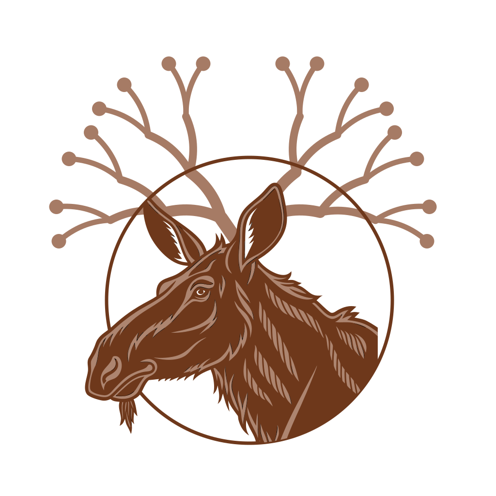
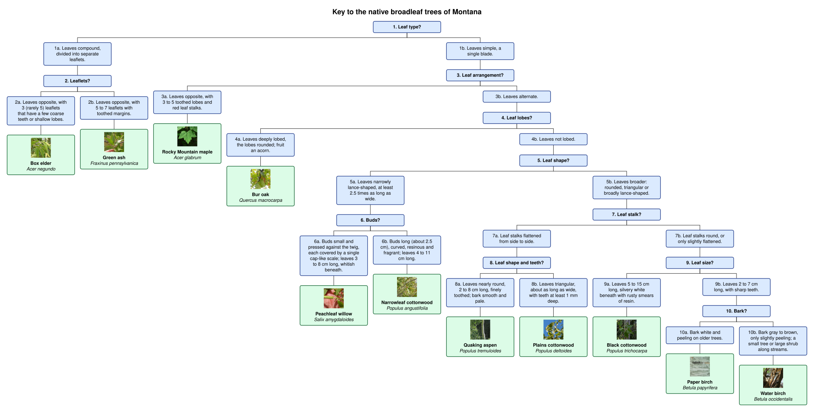
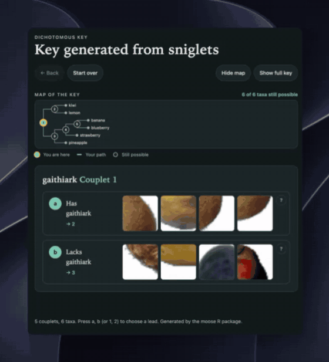

# dimoose 

<!-- badges: start -->
[](https://github.com/leipzig/dimoose/actions/workflows/R-CMD-check.yaml)
[](https://app.codecov.io/gh/leipzig/dimoose)
<!-- badges: end -->

An R package to read, build, check, cut down and share dichotomous keys.

**No R? Use the browser page.** <https://leipzig.github.io/dimoose/webr/>
turns a key kept as a spreadsheet (CSV, with optional photos) into the
interactive page described below. R runs inside your browser, and your files
stay on your computer.

## Dichotomous keys

Dichotomous keys are bifurcating trees that are often used in species identification. More precisely, dichotomous keys are binary categorical decision trees with unique leaves. They have been a staple of taxonomic identification for centuries — Lamarck's *Flore française* (1778) is often credited with popularizing the form — and remain in everyday use in field guides and laboratory manuals today.

### Relationship to phylogenetic trees

Despite their different uses, phylogenetic trees are similar to dichotomous keys:
- the paths are traversed using mutation "decisions" instead of visible phenotypes
- all points on a phylogenetic tree represent an organism that actually existed (instead of a group of possibilities)

dimoose supports phylogenetic trees in which the mutations are known, such as PhyloTree, and ships PhyloTree Build 17 (the human mitochondrial DNA phylogeny, as distributed by Haplogrep 3).

## Package methods

This package provides tools to:
- **read keys people have already written**: plain text as printed in a flora (`keyFromText()`), a spreadsheet (`keyFromSpreadsheet()`), FishBase (`importFishbase()`), and the keys and character matrices of SDD, DELTA, Lucid and Xper (`readSDD()`, `readDELTA()`, `readLucid()`, `readXper()` and their writers)
- **check a key**: `key$validate()` for its structure, `checkNames()` for its species names against GBIF, and `summary()` / `keyQuality()` for how many steps it takes to reach a result
- **cut a key down and join keys up**: `pruneKey()` keeps or drops taxa, `regionalKey()` keeps the taxa recorded in a place, `mergeKeys()` grafts one key onto a result of another
- **generate a key from a character matrix** (`keyFromMatrix()`), with taxa that vary in a character reached down both leads, cheap characters asked first and characters limited to a season
- **generate keys from photos or sequences** with a vision model (CLIP, BioCLIP, or any model that produces embeddings) or from a multiple sequence alignment with a phylogeny program, and **follow those keys by machine**
- **share a key** as a self-contained, mobile-friendly HTML page (`exportWizard()`: "I'm not sure", offline use, characters in any order), a box diagram (`keyDiagram()`) or a spreadsheet (`keyToSpreadsheet()`)
- **test photo identification on field photos** (`inatPhotos()`, `benchmarkKey()`)
- convert a key to a `data.tree` (`key$toDataTree()`), Newick, `igraph`, a `tidytree` `treedata` for `ggtree`, and Nextstrain/Auspice JSON, and read Haplogrep trees
- keep provenance and guide images with the key (`key$meta`)

# Getting started

## Installation

Install dimoose from [R-universe](https://leipzig.r-universe.dev/dimoose),
which has ready-built versions for Windows, macOS and Linux:

```r
install.packages("dimoose", repos = c("https://leipzig.r-universe.dev", "https://cloud.r-project.org"))
```

The package was called moose until version 0.1.0; it was renamed because CRAN
has an unrelated package of that name.

Or install the current source from GitHub:

```r
install.packages("remotes")
remotes::install_github("leipzig/dimoose")
```

That is enough to read, build, check and export keys. Some features use
optional packages, which are only needed if you use that feature:

| Feature | Also needs |
|---|---|
| Keys from a sequence alignment (`keyFromAlignment()`) | `ape`, and `phangorn` for midpoint rooting, UPGMA, parsimony, maximum likelihood and proteins |
| Keys from photos (`visionModel()`, `embedImages()`) | `reticulate` (1.41 or later), which sets up Python and its packages on first use |
| Keys from photos without PyTorch (`visionModel(backend = "onnx")`), saved embeddings (`saveEmbeddings()`) | `reticulate` and `jsonlite`; `jsonlite` alone to load saved embeddings |
| Regional keys and occurrence weights (`regionalKey()`, `occurrenceWeights()`), name checks (`checkNames()`) | an internet connection; no extra packages |
| Diagrams as PNG or PDF, small thumbnails, the app icon of an offline key | `rsvg`, `magick` |
| Phylogenetics exports (`toTreedata()`, `toIgraph()`, `toAuspiceJSON()`) | `tidytree`, `tibble` and `ape`; `igraph`; `jsonlite` |

To install all of the optional R packages at once, and build the vignettes:

```r
remotes::install_github("leipzig/dimoose", dependencies = TRUE, build_vignettes = TRUE)
```

## A first key

```r
library(dimoose)
sharks <- sharkKey()
summary(sharks)
exportWizard(sharks, "sharks.html")   # an interactive, self-contained wizard
```

To write your own key in a spreadsheet, see [A photo key to Montana's broadleaf trees](vignettes/montana-hardwoods.Rmd). To start from a key somebody else published, see [From a published key to a field key](vignettes/published-key.Rmd). There are also vignettes on automated key generation [from photos](vignettes/vision-keys.Rmd) and [from a sequence alignment](vignettes/alignment-keys.Rmd).

## Included datasets

Five example keys ship with the package. They come from very different sources and are built in different ways, but they are all ordinary dimoose objects: they share the same fields (`leads`, `df`, `meta`, `taxa`, `desc`) and methods (`print()`, `summary()`, `validate()`, `toDataTree()`, `toNewick()`) and all work with `exportWizard()` and the phylogenetics exports.

### Sharks — `sharkKey()`

FishBase key 1, the *Key to the families of sharks in the Western Central Pacific* (Compagno 1998), parsed from saved FishBase pages in `inst/extdata/fishbase/`. A classic, human-authored morphological key: **23 couplets, 24 families**. It carries guide-image links, so the exported wizard shows a figure at each lead. This is the key the `importFishbase()` / `parseFishbase()` machinery produces from a live or saved FishBase page.

### Arachnids — `arachnidaKey()` (dataset `arachnida`)

The *Key to the Orders of Arachnida* from Triplehorn & Johnson (2005), *Borror and DeLong's Introduction to the Study of Insects*, 7th ed., transcribed by hand (see `data-raw/arachnida/`). **11 couplets, 11 orders** (Schizomida is reached from two couplets, so it is a small DAG rather than a strict tree). The `arachnida` dataset is the underlying table of leads; `keyFromLeads()` turns it into the key.

### Vibrio — `vibrioKey()` (dataset `vibrio`)

A key **generated** from a biochemical consensus matrix rather than written by a person. The `vibrio` dataset is the identification matrix of Noguerola & Blanch (2008), **74 taxa × 45 tests** (`+`/`-`/`(+)`/`(-)`/`v`/`ND`). `vibrioKey()` recodes it with `vibrioMatrix()` (`+` and `(+)` positive, `-` and `(-)` negative, `v` variable, `ND` unknown) and builds the key with `keyFromMatrix()`: a **92-couplet** key, up to 10 steps deep, that separates all 74 species. A species that is variable or undetermined for a test is reached down both leads of every couplet that uses the test, so 14 species turn up at two or three results (93 results in all). `vibrioKey(variable = "missing")` gives the earlier `rpart` tree instead (`keyFromRpart()`): 73 couplets, up to 18 steps deep, each species at one result, with variable results treated as missing. This is the template for turning any feature matrix into a dichotomous key.

### PhyloTree — `phylotreeKey()` (datasets `phylotree17`, `phylotree17_mutations`)

PhyloTree Build 17, the human mitochondrial DNA phylogeny (van Oven 2015), as distributed by Haplogrep 3: **5,435 haplogroups** and **13,384 mutations**. `phylotree17` is one row per haplogroup (name, parent, depth, subclade count, mutations); `phylotree17_mutations` is one row per mutation (position, type, ancestral/derived base). `phylotreeKey()` turns the tree, or any subtree, into a key whose "characters" are the defining mutations — for example `phylotreeKey("H2a")`. The full tree is large (2,420 steps), so a subtree or a `maxDepth` is usually more practical for the wizard. This is the "phylogenetic tree as a key" case, where the decisions are mutations rather than visible phenotypes.

### Montana broadleaf trees — `montanaKey()` (dataset `montana`)

A key to the **eleven native broadleaf (hardwood) trees of Montana**, written for dimoose: **10 couplets, 11 species**, each checked as native in the [Montana Field Guide](https://fieldguide.mt.gov) and USDA PLANTS, with 14 photos from Wikimedia Commons (most taken in Montana by Matt Lavin). It is kept as a plain spreadsheet, `inst/extdata/montana/montana-key.csv`, next to its photos, and `keyFromSpreadsheet()` turns it into the key, so it doubles as a template: copy the folder, edit the sheet in Excel or Google Sheets, and build your own key in one line. `keyFromSpreadsheet(file, checkNames = TRUE)` also checks the species names against [GBIF](https://www.gbif.org) and points out misspellings and outdated synonyms by spreadsheet row. `keyDiagram()` draws any key as a box diagram, and `exportWizard()` turns it into a page you can use on a phone: [try the Montana key](https://leipzig.github.io/dimoose/montana/).



# Working with keys people have written

## A key from plain text

Most keys exist only as text in a flora or a paper. `keyFromText()` reads the
usual layouts (bracketed `1a`/`1b`, `1.`/`1'.`, lettered, indented; dot
leaders, wrapped lines, page headers) and builds a checked key:

```r
file  <- system.file("extdata", "textkeys", "trees-bracketed.txt", package = "dimoose")
trees <- keyFromText(file)        # a file, one string, or lines of text
trees
#> <dimoose key> Key to the Broadleaf Trees of the Cottonwood Bottoms
#>   8 couplets, 16 leads, 9 taxa, up to 5 steps deep (3.6 on average)
attr(trees, "problems")           # problems, repairs and notes, each with its line number
parseTextKey(file)                # the lead table and the report, without building the key
```

A lead with no destination, a couplet with one lead or a number the scan
garbled is reported with its line, and nothing is dropped. Common OCR slips
(`l` for 1, lost dot leaders) are repaired and reported; `strict = TRUE` stops
instead. For a bad scan, `llm =` takes a function of your own that makes a
first pass with a language model; its answer is checked against the source.
dimoose calls no model itself.

## A regional key: the trees of Flathead County in one line

```r
flathead <- regionalKey(montanaKey(), "Flathead County, Montana", kingdom = "Plantae")
#> Kept 10 of 11 taxa recorded in Flathead, Montana, United States (GADM USA.27.15_1) (GBIF)
attr(flathead, "records")         # every taxon, its record count and whether it was kept
```

`regionalKey()` asks [GBIF](https://www.gbif.org) (or iNaturalist, with
`source = "inat"`) which of the key's taxa have been recorded in a place,
drops the others and closes up the couplets that no longer split anything.
(Not run here: it needs the internet. On 19 November 2026 GBIF had no bur oak
record from the county, so the key lost one species and one couplet.)
`pruneKey(key, keep = "Populus")` does the same from a list of names, and
`mergeKeys(families, genera, at = "Salicaceae")` grafts a second key onto a
result of the first. The character of a couplet that was closed up is kept in
a `Note` column of the leads.

## Exchange with SDD, DELTA, Lucid and Xper

dimoose reads and writes the formats other identification software uses:
SDD, the TDWG standard (`readSDD()` / `writeSDD()` for a matrix, `readSDDKey()`
/ `writeSDDKey()` for a key), DELTA (`readDELTA()` / `writeDELTA()`), Lucid
(`readLucid()` / `writeLucid()` for matrix keys, `readLucidKey()` /
`writeLucidKey()` for pathway keys) and Xper2/Xper3 through their SDD export
(`readXper()` / `writeXper()`). Every matrix reader returns the same list, and
its `$matrix` goes straight into `keyFromMatrix()`:

```r
d <- readDELTA(system.file("extdata", "tdwg", "beetles-delta", package = "dimoose"))
d$matrix[1:4]
#>                 Taxon antennal club     pronotum           eyes
#> 1 Aphodius exemplaris       present black/yellow of normal size
#> 2      Carabus fictus        absent    red/black     very large
#> 3 Lucanus imaginarius       present        black of normal size
key <- keyFromMatrix(d$matrix)
writeSDD(d, "beetles.sdd.xml", key = key)   # the matrix and the key in one SDD file
writeLucid(d, "beetles.csv")                # for the Lucid Builder
```

The files dimoose writes have not yet been opened in Lucid, Xper or a DELTA
program; the help pages say what each format can and cannot carry.

## How good is a key?

```r
montanaKey()
#> <dimoose key> Key to the native broadleaf trees of Montana
#>   10 couplets, 20 leads, 11 taxa, up to 7 steps deep (4.6 on average)
summary(montanaKey())[c("meanTaxonSteps", "expectedSteps", "bound", "efficiency")]
keyQuality(montanaKey())$taxa     # steps to reach each taxon
```

`bound` is the average number of steps the best possible key to the same taxa
would need, and `efficiency` is that bound over the steps this key takes. A key that reaches
common species quickly is better than its plain average says:
`summary(key, weights = occurrenceWeights(key, region = "USA.27_1", kingdom = "Plantae"))`
weights each taxon by its GBIF records in a region, here Montana (not run
here: needs the internet).
Real keys rarely reach an efficiency of 1, because the characters that would
split the taxa evenly may not exist; use it to compare keys to the same taxa.

## Edit any key in a spreadsheet

```r
csv   <- keyToSpreadsheet(sharkKey(), "sharks/key.csv")   # the CSV keyFromSpreadsheet() reads
# ... edit it in Excel or Google Sheets ...
key   <- keyFromSpreadsheet(csv, desc = "Sharks")
```

Photos embedded in the key are written beside the CSV. Only the template's
seven columns are written: the title, the citation and links to taxon pages
are not.

# The interactive page

`exportWizard(key, "key.html")` writes one HTML file that asks one couplet at
a time, with a trail, Back and a map of the key. Without JavaScript it reads
as a plain key.

- **"I'm not sure."** Every couplet has this choice. It follows all the
  leads; the page keeps the branches that are still open, counts the taxa
  still possible and lists the candidates at the end.
- **Offline.** `exportWizard(key, "key.html", offline = TRUE)` also writes a
  web app manifest, a service worker and two icons. Put all five files in one
  folder of an `https` site, open the page once, and it can be installed on a
  phone and opened without signal. This has been tested with a simulated
  browser, not yet on a phone.
- **Any character first.** `exportWizard(key, "key.html", matrix = m,
  characters = ch)` adds a list of the matrix's characters to answer in any
  order, cheapest first; a taxon that varies in a character fits either
  state. `exportWizard(NULL, "key.html", matrix = m)` makes that page with no
  key at all.
- **From a photo.** `exportWizard(key, "key.html", photoModel = dir)`, with
  `dir` a folder written by `exportBrowserModel()` for the same key, adds an
  "Identify from a photo" button. The model runs in the reader's browser, so
  the photo never leaves the device; the page marks the likely taxa and
  offers to narrow the key to them. The photo is a hint and the key stays the
  authority. The model is a large download (an int8 BioCLIP encoder is about
  90 MB), fetched only when the reader agrees to it. See `?exportWizard`.

# Automated key generation

Most keys are written by people. dimoose can also generate one from data: from
a character matrix, a multiple sequence alignment, or a pile of photos. Either way the result
is an ordinary dimoose key that works with `exportWizard()`, `classify()` and
the phylogenetics exports.

## From a character matrix

A matrix has one row per taxon and one column per character. `"/"` separates
the states of a taxon that varies, and `NA` means unknown:

```r
trees <- data.frame(
  Taxon    = c("Box elder", "Green ash", "Paper birch", "Water birch"),
  Leaves   = c("compound", "compound", "simple", "simple"),
  Leaflets = c("3/5", "5/7", NA, NA),
  Bark     = c("furrowed", "furrowed", "white, peeling", "coppery, not peeling"))
key <- keyFromMatrix(trees)
key$leads[c("Statement", "Character", "Next", "Taxon")]
#>   Statement                  Character Next                 Taxon
#> 1         1           Leaves: compound    2
#> 2         1             Leaves: simple    4
#> 3         2                Leaflets: 3    -             Box elder
#> 4         2           Leaflets: 5 or 7    3
#> 5         3                Leaflets: 5    - Box elder / Green ash
#> 6         3                Leaflets: 7    -             Green ash
#> 7         4       Bark: white, peeling    -           Paper birch
#> 8         4 Bark: coppery, not peeling    -           Water birch
```

Box elder has three or five leaflets, so it is reached down both leads of
couplet 2, and a leaf with five, which could be either tree, ends at both
names. An optional table of characters says what each one costs to observe and
when it can be seen; cheap characters are asked first, and `season` leaves out
the ones that are not there:

```r
chars <- data.frame(Character = c("Leaves", "Leaflets", "Bark"),
                    Cost = c(1, 1, 2), Season = c("summer", "summer", ""))
keyFromMatrix(trees, characters = chars, season = "winter")$leads[c("Character", "Taxon")]
#>                                      Character                 Taxon
#> 1                               Bark: furrowed Box elder / Green ash
#> 2 Bark: white, peeling or coppery, not peeling
#> 3                         Bark: white, peeling           Paper birch
#> 4                   Bark: coppery, not peeling           Water birch
```

`generateTree()` and `keyFromRpart()` fit an `rpart` classification tree
instead.

## From a multiple sequence alignment

One command takes aligned sequences to a key. A phylogeny program builds the
tree, dimoose roots it, and every fork becomes a couplet whose leads are the
alignment sites that tell its two sides apart:

```r
library(dimoose)
fasta <- system.file("extdata", "aligned.fasta", package = "dimoose")   # or the path of your own FASTA file
key <- keyFromAlignment(fasta)
exportWizard(key, "key.html")

head(key$leads[, c("Statement", "Character", "Next", "Taxon")], 4)
#>   Statement      Character Next   Taxon
#> 1         1       106G 35G    2
#> 2         1       106A 35A    3
#> 3         2 201T 234C 297G    -   No305
#> 4         2 201C 234T 297A    - No1114S
```

`aligned.fasta` is an example that ships with dimoose: 15 wood mouse cytochrome
*b* sequences. A second one, `mtdna.fasta`, has whole human mitochondrial
genomes for 14 haplogroups. Numbered by the sequence of the rCRS's haplogroup
and rooted on L0, its key asks about the familiar PhyloTree positions:

```r
mtdna <- system.file("extdata", "mtdna.fasta", package = "dimoose")
mt <- keyFromAlignment(mtdna, reference = "H2a2a1", outgroup = "L0a1")
mt$leads[7:8, c("Statement", "Character", "Next")]
#>   Statement         Character Next
#> 7         4 8701A 9540T 10873T    5
#> 8         4 8701G 9540C 10873C   12
```

Options:

- **The phylogeny program** is chosen with `tool`: `"nj"` (the default) and `"bionj"` use
  `ape`; `"upgma"`, `"parsimony"` and `"ml"` use `phangorn`; `"fasttree"` and
  `"iqtree"` run the FastTree or IQ-TREE program if it is installed.
- **A tree from any other program** goes in as `tree = "my.nwk"` (a Newick file).
- **The root** is the `outgroup` you name, or the midpoint.
- **Site numbers** are alignment columns, or positions in a `reference` sequence.
- **New sequences** are placed with `classify(key, alignmentScores(key, new))`.

See the [alignment vignette](vignettes/alignment-keys.Rmd).

## From a pile of photos

<a href="media/sniglets.mp4"></a>

*A key built from the example photos, followed in the wizard that
`exportWizard()` writes. Each choice asks about one sniglet and shows
crops of it. ([Full-quality video](media/sniglets.mp4))*

You need photos, and a label for each one saying what it shows. The photos
are embedded with a vision model (CLIP ViT-B/32 by default) that runs in
Python, but there is nothing to install by hand: the first `visionModel()`
call sets up a private Python with the packages it needs (through
`reticulate`, 1.41 or later) and reuses it afterwards. That first call
downloads several gigabytes, mostly PyTorch. For a much smaller
install, or none, see [a lighter setup](#a-lighter-setup-onnx-and-saved-embeddings).

Then it is five steps. They run as written on the example photos that ship
with dimoose: 36 small photos of six fruits, from the
[Fruits-360](https://github.com/fruits-360/fruits-360-100x100) dataset
(CC BY-SA 4.0). For your own photos, give the path of your folder instead.

```r
library(dimoose)

# 1. Photos and labels. With one folder per class (pics/banana/..., pics/kiwi/...),
#    each photo is labelled by its folder.
pics   <- system.file("extdata", "pics", package = "dimoose")
images <- imageSet(pics)
#    Class in the file name:  imageSet("my_photos", label = function(x) sub("_.*$", "", x))
#    Labels in a table:       imageSet(tab$file, label = tab$species)

# 2. A vision model
model  <- visionModel()                          # regular CLIP; for organisms, visionModel(name = "bioclip")

# 3. Photos -> embeddings: one for each photo, and one for each of 4 x 4
#    overlapping tiles of it, so that features are local parts of the photo
emb    <- embedImages(model, images)

# 4. Generate sniglets (kinds of region that recur across photos, each given a
#    coined name) and grow a key on them
sniglets <- discoverSniglets(emb$patches, k = 40)
scores   <- snigletScores(emb$patches, sniglets$centroids)
key      <- keyFromSniglets(scores, images, sniglets, method = "rpart")

# 5. Add example crops and export an interactive page
key    <- patchExemplars(model, key, images)
exportWizard(key, "key.html")

# Identify a new photo with the key
new <- list.files(system.file("extdata", "new-photos", package = "dimoose"), full.names = TRUE)
classify(key, scoreImages(key, model, new))
```

With one photo per class, use the default `method = "balanced"` in step 4
(the [fordera](https://github.com/leipzig/fordera) method).

### Sniglets, and renaming them

The features in step 4 are found by the model, by clustering the tiles of
all the photos: each one is a kind of region that several photos have in
common, such as a rough skin or a stem end. They have no names, so dimoose
coins a pronounceable word for each one (`gaithiark`, `glienglaund`) and
calls these **sniglets**. Both leads of a couplet describe something: one
reads "Has glienglaund" and the other, where it can, says what those photos
have instead ("Lacks glienglaund; has laussym"). The wizard shows example
tiles on both leads, taken from every class that follows that lead. Once you
have looked at them, give the sniglets real names:

```r
snigletNames(key)                 # coined word, current name, definition, used by the key?

key <- renameSniglets(key, c(gaithiark = "a dull, finely textured skin"),
                      definitions = c(gaithiark = "Matt skin with a fine grain, as on a kiwi or a lemon"))

# or name them in a spreadsheet
write.csv(snigletNames(key), "names.csv", row.names = FALSE)   # fill in name and definition
key <- renameSniglets(key, "names.csv")
exportWizard(key, "key.html")     # leads now read "Has a dull, finely textured skin"
```

The coined word stays as the sniglet's permanent identifier: scores, machine
tests and saved name tables keep working after a rename, and a blank name
puts the coined word back. Only the names of sniglets the key uses matter.

### Questions from a vocabulary

To ask questions in plain words from the start, give a vocabulary of
contrasting features instead:

```r
vocab  <- data.frame(feature  = c("a smooth skin", "a round shape", "a yellow colour", "green leaves on top"),
                     opposite = c("a rough skin", "a long shape", "a dark colour", "no leaves"))
txt    <- embedTexts(model, vocabularyPrompts(vocab, "a photo of a fruit with {x}"))
qkey   <- keyFromClusters(emb$image, images, vocab, txt, template = "a photo of a fruit with {x}")
```

The [photo vignette](vignettes/vision-keys.Rmd) explains each step, and how
to measure a key's accuracy.

### Choosing a model: CLIP or BioCLIP

The model is chosen in step 2, by the `name` you give `visionModel()`:

| Your photos | Model | Call | First download |
|---|---|---|---|
| Anything: objects, products, vehicles, mixed subjects | CLIP ViT-B/32 (OpenAI), the default | `visionModel()` | about 350 MB |
| Organisms: plants, animals, fungi, specimens | [BioCLIP](https://imageomics.github.io/bioclip/) | `visionModel(name = "bioclip")` | about 600 MB |
| Organisms, when accuracy matters more than speed | [BioCLIP 2](https://huggingface.co/imageomics/bioclip-2) | `visionModel(name = "bioclip-2")` | about 1.7 GB |

For example, to build the key above with BioCLIP, replace step 2 with:

```r
model <- visionModel(name = "bioclip")
```

- **Only that one line changes.** `embedImages()`, `discoverSniglets()`,
  `keyFromSniglets()`, `patchExemplars()` and `exportWizard()` are called the
  same way with every model.
- **Build and follow a key with the same model.** The key records which
  model made it, and `scoreImages()` warns, or stops, if you give it a
  different one.
- **With BioCLIP, use sniglets.** Its text side was trained on names of
  organisms, not on descriptions of what they look like, so vocabulary
  questions (`keyFromClusters()`) work better with regular CLIP.
- **BioCLIP 2 is a larger model**, so embedding takes several times longer.

BioCLIP 2 also recognises many species from their scientific name alone, with
no example photos. `suggestSpecies()` uses this to check a photo against a key
you already have: it ranks only the key's own species, which is far more
reliable than asking the model to pick from every species it knows.

```r
model <- visionModel(name = "bioclip-2")
suggestSpecies(montanaKey(), model, "my-tree.jpg")   # the 3 best of the key's 11 species, with probabilities
```

`identifyPhotos()` gives one answer per photo instead, and steps up to the
genus, family or order (from GBIF) when no single species is likely enough:
a cottonwood it cannot place between the key's two cottonwoods comes back as
genus *Populus*.


Other models: `name = "hf-hub:<organisation>/<model>"` loads any open_clip
model on the Hugging Face Hub whose image side is a vision transformer, and
`name = "local-dir:<folder>"` loads a copy you have downloaded.

No Python at all: the R side works on plain matrices, so if you already have
embeddings from some other encoder, pass them straight to
`discoverSniglets()`, `keyFromSniglets()`, `keyFromClusters()` and
`featureScores()`.

### A lighter setup: ONNX and saved embeddings

- **Without PyTorch.** `visionModel(backend = "onnx")` runs the same CLIP
  ViT-B/32 on ONNX Runtime, a much smaller Python install, and gives the same
  embeddings: on the 36 example photos the key above comes out the same.
  `precision = "fp16"` or `"int8"` picks a smaller copy of the model. BioCLIP
  has no ready-made ONNX copy; convert it once with
  `exportOnnxModel("bioclip")` on a computer that has PyTorch, then use
  `visionModel(name = "bioclip", backend = "onnx")` anywhere.
- **Without Python.** Embed once and keep the result:

  ```r
  saveEmbeddings(embedImages(model, images), "pics.safetensors")
  emb <- loadEmbeddings("pics.safetensors")   # needs only jsonlite
  ```

  `discoverSniglets()`, `snigletScores()` and `keyFromSniglets()` then run as
  in step 4.
- **In a browser.** `exportBrowserModel(key, model, dir)` writes an image
  encoder and the embedded names of a key's species, the files a web page
  needs to rank those species for a photo on the visitor's own device.

### Suggested names for sniglets

`suggestSnigletNames()` shows a vision-language model each sniglet's example
crops and returns the table `renameSniglets()` takes, so naming becomes
reviewing suggestions:

```r
suggestSnigletNames(key, claudeNamer(), file = "names.csv")   # after patchExemplars()
# ... review names.csv ...
key <- renameSniglets(key, "names.csv")
```

The model is any `function(images, prompt)` that returns text.
`claudeNamer()` makes one for the Anthropic API; it needs an
`ANTHROPIC_API_KEY`, its calls are billed to that key, and it has not yet been
run against the live API (the snippet above was run with a stand-in model).
Names are kept short and distinct, and a name that contains a class or
species name is refused.

### How well does it do on field photos?

```r
photos <- inatPhotos(montanaKey(), n = 20, dir = "~/inat-photos")   # research-grade, openly licensed; writes manifest.csv
model  <- visionModel(name = "bioclip-2")
benchmarkKey(montanaKey(), photos, model)   # species ranked from their names
benchmarkKey(model, photos)                 # a photo key built from 70% of the observations, tested on the rest
```

A first run is in [`analysis/inat-benchmark/`](analysis/inat-benchmark/): 220
iNaturalist photos, 20 for each of the eleven Montana species, with BioCLIP 2,
on 19 November 2026.

| Route | Test photos | Top-1 | Top-2 |
|---|---|---|---|
| names: the key's eleven species ranked from their scientific names | 220 | 97.3% (214) | 100% |
| build: a sniglet key built from 154 training photos | 66 | 71.2% (47) | n/a |

Read the limits before quoting these numbers. It is one run on one small
sample, with one split and one model. BioCLIP 2 has very likely seen photos
like these, perhaps these very ones, so 97% is an upper estimate of what to
expect on your own photos. The model only had to choose among the key's own
eleven species, the photos are research-grade observations from the species'
whole range and not from Montana, and 101 of the 220 were taken in June. The
[benchmark's README](analysis/inat-benchmark/README.md) has the full list.

# Mixed-effects conditional inference trees

`mecit()`, `keyFromMecit()` and `simulateExpression()` now live in the companion package [mecit](https://github.com/leipzig/mecit); `haplotypeMatrix()`, `recurrentPositions()` and `macroHaplogroup()`, which turn PhyloTree haplogroups into the 0/1 site matrix those trees split on, are still here.

# Interoperating with phylogenetics tools

A dimoose key is a tree, so it can be handed to the usual phylogenetics software:

```r
k <- phylotreeKey("H2a")
toNewick(k)                         # quoted Newick, or labels = "safe" + a sidecar table
toNewick(k, annotate = "nhx")       # lead text as NHX/BEAST comments
toTreedata(k)                       # a tidytree treedata for ggtree
toIgraph(k)                         # a DAG-faithful igraph (keeps shared couplets)
toAuspiceJSON(k)                    # Nextstrain/Auspice v2 JSON
readHaplogrep("tree.xml")           # load any Haplogrep / PhyloTree tree XML
```

# Related software

[Lucid](https://www.lucidcentral.org), [Xper3](https://www.xper3.fr) and the
[DELTA](https://www.delta-intkey.com) programs build and run interactive keys
from character matrices; dimoose reads and writes their exchange formats
rather than replacing them. In R, `rfishbase` gives FishBase's data tables and
`taxize` resolves taxonomic names; dimoose imports FishBase's keys and checks
a key's names against GBIF.

# Citing and contributing

To cite dimoose, run `citation("dimoose")`. Bug reports, keys that fail to
import and pull requests are welcome: see [CONTRIBUTING.md](CONTRIBUTING.md).

# Acknowledgments

dimoose stores keys as an R6 object over a lead table, uses data.tree and rpart for its trees, and bridges to ape, tidytree and igraph.

FishBase key import is made possible by the work of Scott Chamberlain and Carl Boettiger on rOpenSci's `rfishbase` and the R tooling for FishBase data.

The bundled PhyloTree Build 17 is taken from [Haplogrep](https://haplogrep.i-med.ac.at/), whose tree files and documentation of PhyloTree's notation made the PhyloTree key possible. Thanks to the Haplogrep authors (Schönherr, Weissensteiner, and others) at the Institute of Genetic Epidemiology, Medical University of Innsbruck and to Mannis van Oven for PhyloTree itself.

The image-based key work builds on the [Imageomics Institute](https://imageomics.osu.edu/) and the NSF HDR-BGNN (Harnessing the Data Revolution — Biology-Guided Neural Networks) effort, whose BioCLIP and TreeOfLife models make domain-specific biological embeddings possible.

Dimoose was built in Whitefish, Montana. The moose depicted in the logo is named Dichotomoose.
